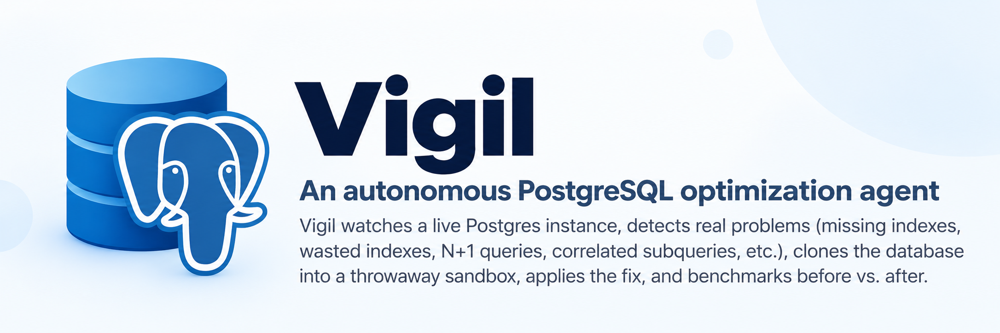
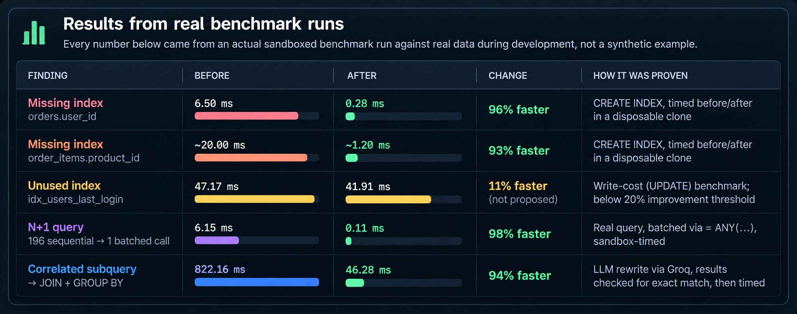
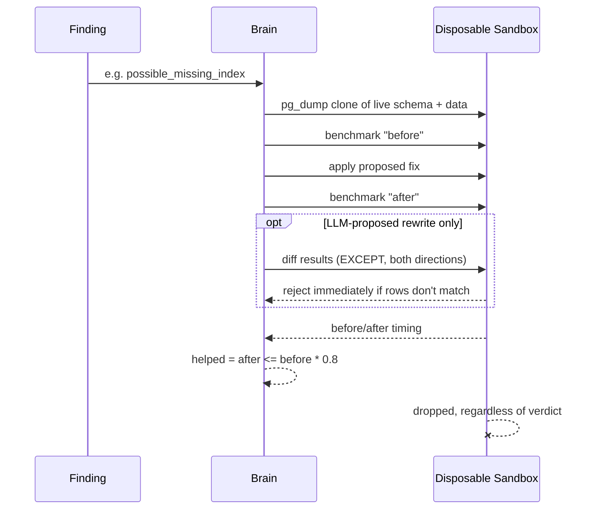
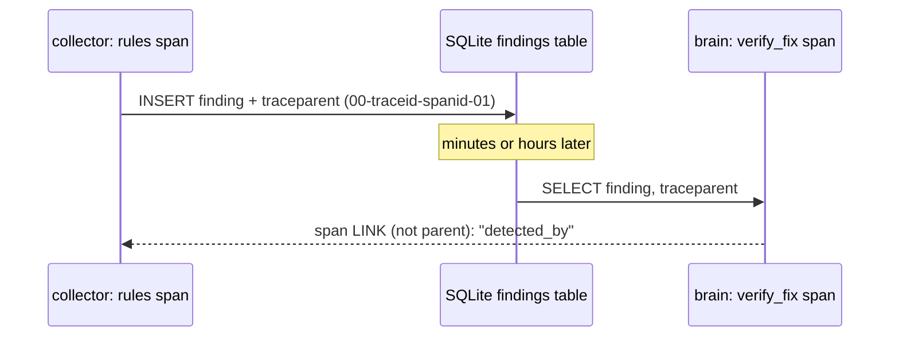
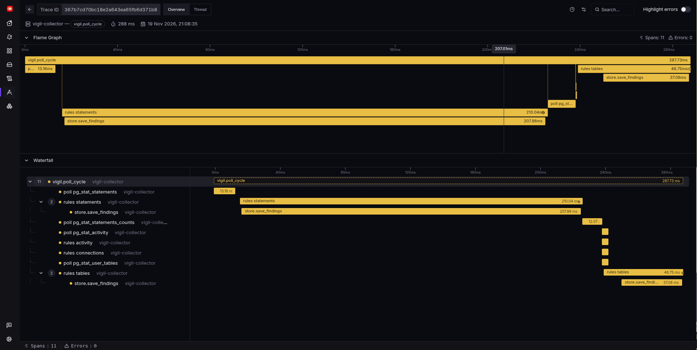
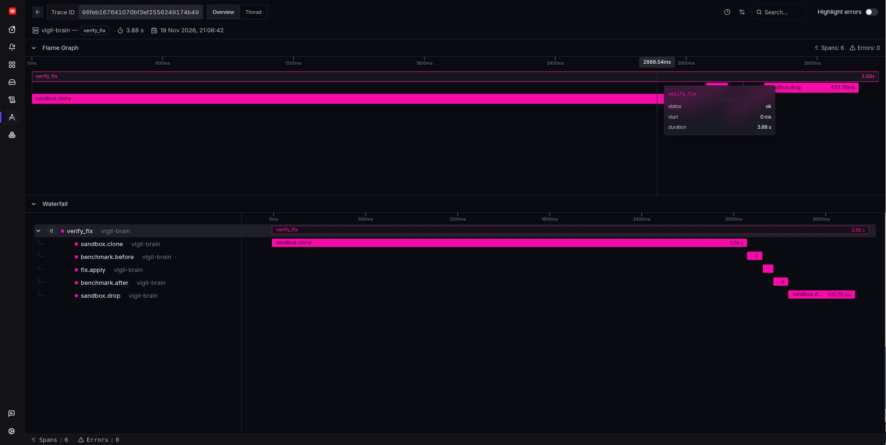
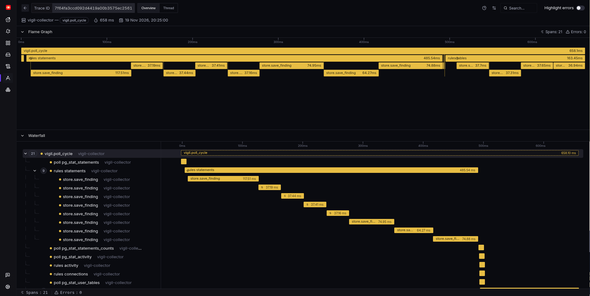
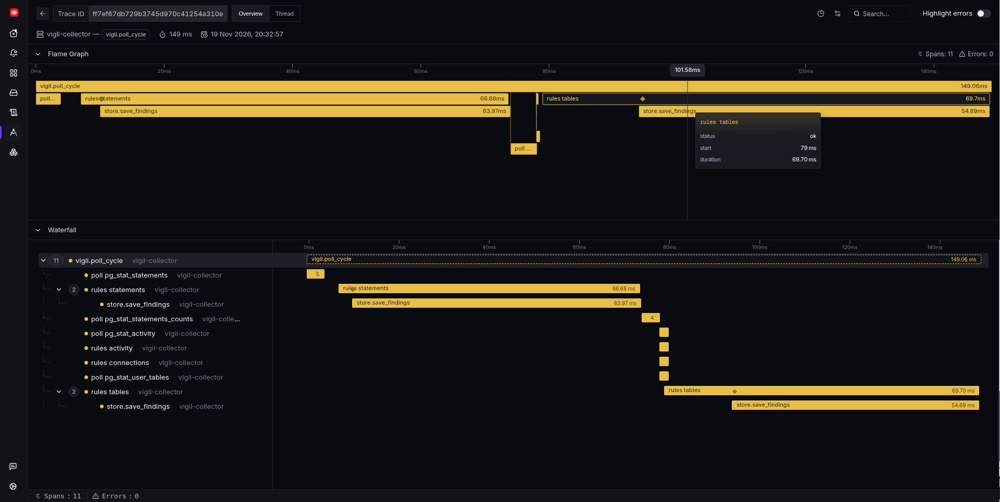
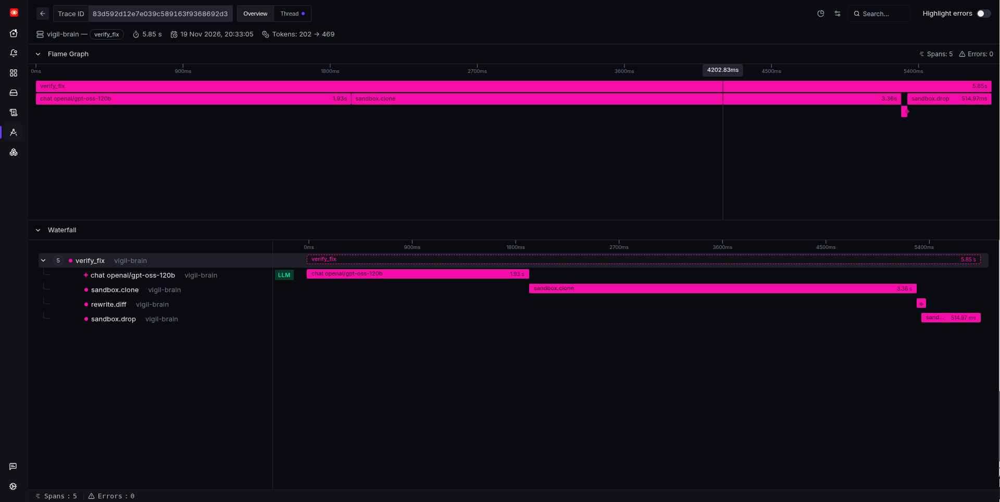
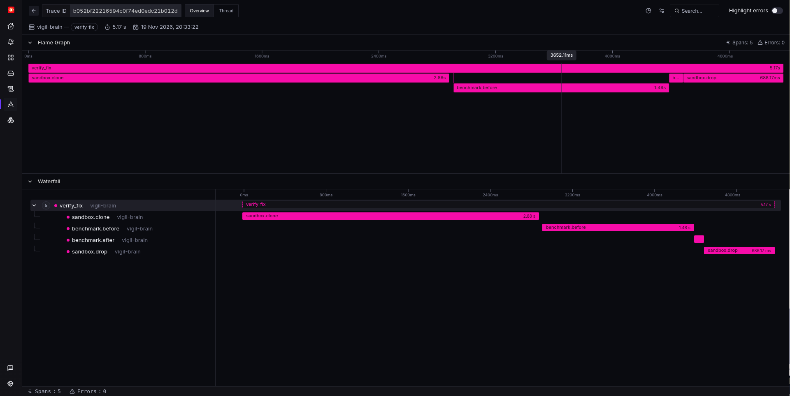

# Vigil



Vigil watches a live Postgres instance, detects real problems (missing indexes, wasted indexes, N+1 query patterns, correlated subqueries, unbounded result sets, stuck transactions, connection exhaustion), and for anything it can *fix* rather than just *flag*, it clones the database into a throwaway sandbox, applies the fix, and benchmarks before vs. after. If the fix doesn't measurably help — or, for LLM-proposed rewrites, doesn't even return the same results — it's silently discarded. Nothing gets proposed on a guess.

---

## What's actually built

Every row below reflects real, working code — not a roadmap. All seven detection rules run end-to-end today; the columns show what happens *after* detection.

| Detection rule | Fix generation | Verification | Output |
|---|---|---|---|
| `possible_missing_index` | Deterministic (`CREATE INDEX`) | ✅ Sandbox-benchmarked (read latency) | PR draft (dry-run) |
| `possible_unused_index` | Deterministic (`DROP INDEX`) | ✅ Sandbox-benchmarked (write latency) | PR draft (dry-run) |
| `nested_subquery` | LLM-proposed rewrite (Groq) | ✅ Sandbox correctness-checked *and* benchmarked | Console (PR generation not built yet) |
| `possible_n_plus_one` | Deterministic (batch via `= ANY(...)`) | ✅ Sandbox-benchmarked (N sequential calls vs. 1 batched call) | Console (PR generation not built yet) |
| `possible_unbounded_query` | — (result-set size is an API contract decision, not a bug) | — | Live alert (dry-run Slack) |
| `idle_in_transaction` | — (operational, nothing to benchmark) | — | Live alert (dry-run Slack) |
| `approaching_max_connections` | — (operational, nothing to benchmark) | — | Live alert (dry-run Slack) |

"Dry-run" means the migration file, PR body, and Slack message are all generated for real and written/printed — nothing is actually pushed to GitHub or posted to Slack yet. That's a deliberate, explicit line (see [What's next](#whats-next)), not an oversight.

---

## Results — real numbers, not estimates

Every number below came from an actual sandboxed benchmark run against real data during development, not a synthetic example.



The unused-index row matters as much as the fast ones: it's the system correctly saying *no*. A tool that only ever reports wins isn't proving anything.

---

## Architecture


### The sandbox: "prove it, don't trust it" in detail



Every sandbox is a full `pg_dump`/`psql` clone of the live database, created fresh and dropped immediately after — nothing persists between checks, and nothing is ever benchmarked against synthetic data. The 20%-improvement bar (not just "any improvement") exists specifically to filter out noise: the unused-index result above (11% faster) shows it working as intended.

---

## A bug this project found in itself

Midway through building the third detection rule, the system started reporting the same two confusing things every run: a phantom "missing index" on `users.id` (already a primary key — impossible) and a 117-way explosion of false `nested_subquery` findings.

The root cause turned out to be one query with a missing scope: `pg_stat_statements` is **cluster-wide**, not per-database, and the collector's polling query had no `WHERE dbid = ...` filter. Every disposable sandbox this same system creates and drops runs its own benchmark queries — and `pg_stat_statements` doesn't clean those up when the database is dropped. A direct check confirmed it: **4,872 total tracked statements, only 162 belonging to live databases** — the other 4,710 (97%) were orphaned rows from already-deleted sandbox clones, silently getting correlated against the real database's stats.

One `WHERE dbid = (SELECT oid FROM pg_database WHERE datname = current_database())` fixed both symptoms at once, because they'd always been the same bug. Five other real bugs were found and root-caused the same way during development — a Cloudflare 403 that had nothing to do with the API key, SQLite's default journal mode silently blocking concurrent readers, a regex that attributed a WHERE-clause filter to the wrong table in a JOIN — kept as personal notes, not published in this repo.

The correctness check in the sandbox caught its own class of bug too: when pointed at real, gnarly Postgres internals (via `pg_dump`'s own catalog queries), the LLM produced plausible-*looking* rewrites for 8 different queries — 6 of them were subtly wrong (different result sets) and were rejected automatically, before their timing was ever considered. *(Tracing later showed that some of those rejections were Vigil's checker being wrong, not the LLM — see below.)*

---

## Observability: Vigil instrumented with OpenTelemetry, viewed in SigNoz

A tool that watches someone else's database should be able to answer questions about *itself*: how long does a poll take, which fixes actually helped, how often is the LLM wrong. All three services export traces and metrics over OTLP to a self-hosted [SigNoz](https://signoz.io). Nothing in the code names SigNoz; it's configured entirely through the standard `OTEL_*` environment variables.

| Service | How | Traces | Metrics |
|---|---|---|---|
| `vigil-demo-app` (FastAPI) | Zero-code: `opentelemetry-instrument` | One span per HTTP request + one per SQL statement, so an N+1 shows up as a waterfall of ~100 `SELECT`s | — |
| `vigil-collector` (Go) | Manual, OTel Go SDK | One trace per poll cycle: `poll <source>` → `rules <group>` (each finding as a span event) → `store.save_findings` | `vigil.poll.duration` (histogram, explicit buckets in seconds), `vigil.findings.detected{vigil.rule}`, `vigil.poll.errors{vigil.source}`, `vigil.statements.tracked/orphaned`, `vigil.connections.utilization` |
| `vigil-brain` (Python) | Manual, OTel Python SDK | One trace per finding: `verify_fix` → `chat <model>` (GenAI semconv, token usage) → `sandbox.clone` → `rewrite.diff` → `benchmark.before` → `fix.apply` → `benchmark.after` → `sandbox.drop` | `vigil.fixes.verified{vigil.rule, vigil.verdict}`, `vigil.fix.latency_ratio`, `vigil.llm.rewrites.rejected{reason}` |

### Linking two services that never talk to each other

The collector and brain never call each other: they only meet through the SQLite `findings` table, which acts as a queue. Context propagation still works, just over a different carrier. The collector writes the W3C `traceparent` of the span that *detected* each finding into the row; brain reads it back and starts its verification trace with a **span link** to it:



It's a link, not a parent/child relationship, on purpose. A child is *part of* its parent's operation and falls within its lifetime. Brain's work happens long after a ~150ms poll cycle has ended, the collector never waits for it, and a single brain run handles findings from many cycles. Making it a child would stretch one poll trace across hours. A link says "caused by", which is the standard pattern for anything that goes through a queue. Verified by joining in ClickHouse: 25/25 brain traces linked to a real collector span that carried the same `vigil.finding.id`.

| Found here (collector) | Fixed here (brain, linked) |
|---|---|
|  |  |

### What the telemetry found (things nothing else would have shown)

1. **The collector was spending most of each poll cycle on fsync.** Per-insert spans showed every SQLite write costing a near-constant ~37ms (one WAL commit, one fsync), multiplied by every finding. Batching each cycle's findings into one transaction brought poll cycle **p50 from 557ms to 158ms and p95 from 2,164ms to 462ms** (212 cycles before, 2,894 after).

   | One span per insert | One batched save |
   |---|---|
   |  |  |

2. **Many "rejected" LLM rewrites were rejected wrongly.** The `rewrite.diff` span recorded the actual error: a trailing `;` from the LLM broke the `EXCEPT` wrapper, and placeholder substitution turned `false` into `0`, so even the *original* query couldn't run. The dashboard's "87.5% of rewrites rejected" is partly measuring Vigil's own checker. Fixing that is next.

   

3. **`sandbox.clone` takes about 56% of every verification.** The benchmarks themselves are tiny next to the `pg_dump | psql` clone, which happens once per finding. Cloning from a template database is the obvious next optimisation.

   

4. **Brain's sandboxes are evicting the statistics the collector reads.** The `dbid` filter described above stops orphaned `pg_stat_statements` entries from *polluting* results, but they still take up space. The dashboard showed ~4,700 orphaned entries against ~120 live ones, and `pg_stat_statements.max` is 5,000. `pg_stat_statements_info.dealloc` confirmed Postgres had **already evicted entries 37 times** in five hours. Vigil's verification step is slowly erasing its own input.

5. **Brain's metrics were undercounted.** Brain runs once and exits. With the SDK's default *cumulative* temporality, every run starts a new series whose first point has nothing before it, so `increase()` counts it as zero. The dashboard showed 4 rejected rewrites where the traces showed 9. Switching brain to **delta** temporality made metrics and traces agree exactly. Traces were the ground truth that exposed it.

### Dashboard and alert, as code

The dashboard and alert are created through SigNoz's API from JSON committed in [`infra/signoz/`](infra/signoz/), not built by clicking.

- **Dashboard** ([`dashboards/vigil.json`](infra/signoz/dashboards/vigil.json)), 9 panels: findings by rule over time; fix latency before vs after (from brain's spans); LLM rewrite rejection share and outcomes; fix verdicts by rule; poll duration p50/p95; tracked vs orphaned statements; connection utilization; poll errors.
- **Alert** ([`alerts/postgres-max-connections.json`](infra/signoz/alerts/postgres-max-connections.json)): `vigil.connections.utilization > 0.8` for every point in a 1-minute window. Vigil exports the raw measurement and SigNoz owns the threshold, so it can be tuned without redeploying Go code. It was tested end to end, not with the "test alert" button, which reports a hit at any threshold:
  - `infra/demo-connections.sh` opened 86 idle `pg_sleep` sessions (90/100).
  - The alert fired about 3 minutes later. That delay is the 10s export interval, plus the 1-minute window, plus up to 1 minute until the next evaluation.
  - The webhook payload was received by [`alert-sink.py`](infra/signoz/alert-sink.py).
  - When the sessions ended, the rule went back to inactive and a `resolved` notification arrived.

### Running it

SigNoz runs as its own compose project, and Vigil's services join its `signoz-network`, so **start SigNoz first**:

```bash
cd infra/signoz
foundryctl cast -f casting.yaml     # SigNoz UI on http://localhost:8080
# open the UI and create the admin account; the OTLP receiver stays closed until then

# Settings → Service Accounts → new account → Keys → Add Key, then:
mkdir -p ~/.config/vigil && read -rs k && printf '%s' "$k" > ~/.config/vigil/signoz-api-key && chmod 600 ~/.config/vigil/signoz-api-key

docker run -d --name vigil-alert-sink --network signoz-network \
  -v "$PWD/alert-sink.py:/sink.py:ro" python:3.12-slim python -u /sink.py
./provision.sh                      # channel + dashboard + alert (idempotent)

cd .. && docker compose up -d       # then see "Getting started" below
./demo-connections.sh               # make the alert fire
```

---

## Project structure

```
vigil/
├── collector/              # Go -- polls Postgres stats, runs the 7 detection rules
│   ├── internal/metrics/   #   pg_stat_statements/activity/tables/indexes pollers
│   ├── internal/rules/     #   detection logic (detect.go)
│   └── internal/store/     #   SQLite persistence (WAL mode)
├── brain/                  # Python -- turns findings into proven fixes or alerts
│   └── vigil_brain/
│       ├── fixes/          #   deterministic fix templates (index, n+1 batching)
│       ├── llm/            #   Groq client, used only for nested_subquery
│       ├── sandbox/        #   disposable clone + benchmark + correctness check
│       ├── actions/        #   PR draft / Slack message generation (dry-run)
│       └── alerts.py       #   live operational alerts (no sandbox needed)
├── demo-app/                # FastAPI + SQLAlchemy "victim" app -- deliberately bad
│                             #   query patterns, used to generate real findings
├── infra/                  # docker-compose: Postgres, demo-app, PgBouncer, collector, brain
│   ├── signoz/             #   SigNoz install (Foundry), dashboard + alert JSON, provision.sh
│   ├── demo-orphans.sh     #   creates orphaned pg_stat_statements entries
│   └── demo-connections.sh #   pushes Postgres to ~90% of max_connections (fires the alert)
├── docs/screenshots/       # SigNoz traces/dashboard used in this README
├── public/                  # README images (logo, architecture, results)
├── ROADMAP.md               # everything deliberately deferred, and why
└── learning-log.md          # real bugs hit during development, root-caused
```

---

## Getting started

```bash
git clone <this-repo>
cd vigil/infra

# optional: enables the nested_subquery LLM rewrite path. Everything else
# (index fixes, N+1 batching, all alerts) works without it.
echo "GROQ_API_KEY=<your key>" > .env

# Services export telemetry to SigNoz and join its Docker network, so SigNoz
# must be running first (see "Running it" under Observability above).
# Without it, `up` fails fast: network signoz-network not found.
docker compose up -d

cd ../demo-app
alembic upgrade head    # schema + deliberate flaws (must run before seeding)
python seed.py
python load.py          # separate terminal: generates continuous query traffic

# watch the collector detect things in real time
docker compose logs -f collector

# run brain against whatever's been found so far
cd ../infra
docker compose run --rm brain
```

---

## Design principles

- **Prove it, don't trust it.** Every fix that isn't provably correct-by-construction (an index change can never alter query results) gets benchmarked, and LLM-proposed rewrites additionally get their results diffed against the original before timing counts for anything.
- **Deterministic where possible, LLM only where necessary.** 5 of 7 rules need no LLM at all — index changes and N+1 batching are mechanical transforms with correctness guaranteed by the query shape itself. The LLM is reserved for the one case (subquery→JOIN rewriting) that genuinely requires understanding intent.
- **Operational issues bypass the sandbox.** A stuck transaction or a near-full connection pool needs a human *now* — there's nothing to benchmark in an emergency, so these go straight to an alert instead of through fix-verification.
- **Fail closed, not loud.** A malformed finding, an unreachable LLM, an unrecognized query shape — all of these skip that one item and move on, rather than crashing the whole pipeline or guessing.
- **Least privilege — designed for, not fully implemented yet.** The sandbox currently reuses the same superuser credential as the rest of the dev stack; a real deployment should scope it to a dedicated, narrower role. Tracked honestly in [`ROADMAP.md`](ROADMAP.md), not glossed over.

---

## What's next

The short version — full detail with reasoning for every item is in [`ROADMAP.md`](ROADMAP.md):

- **Go live.** Wire the dry-run PR/Slack output to real `gh pr create` calls and a real Slack webhook, for the rule(s) already fully proven.
- **PR generation for query rewrites.** `nested_subquery` and `possible_n_plus_one` fixes are application-code changes (editing a SQL string in source), not schema migrations — needs a source-diff generator, not the existing Alembic-migration one.
- **Deadlock detection.** Lives in Postgres's log file, not any stats view — a structurally different mechanism than everything built so far.
- **PgBouncer pool-mode recommendation.** Nothing in the current stack actually routes traffic through PgBouncer yet, so there's nothing real to reason about pooling from.
- **Table/index bloat detection.** Built, but disabled — every test so far had autovacuum clean up dead tuples before the threshold was honestly crossed. Needs a bigger, busier table to test against.
- **pgvector/HNSW index health.** The demo app already seeds the exact bug (an HNSW index built on an empty table); nothing detects it yet.
- **Fixes the telemetry pointed at.** Strip the LLM's trailing `;` and stop `false` → `0` placeholder substitution (false rewrite rejections); clone sandboxes from a template database (~56% of verify time); reset a sandbox's `pg_stat_statements` entries when it's dropped (evictions); export `pg_stat_statements_info.dealloc` as a metric and alert on it.
- **Findings staleness/expiry.** The store only ever grows; a finding whose condition has since resolved doesn't currently get marked as such.

---

## Demo app

`demo-app/` is a "victim" application that exists purely to generate realistic bad
query patterns for Vigil to detect and fix. Every endpoint below is deliberately
inefficient or broken — that's the point, not a bug.

### What each endpoint demonstrates

- `GET /orders-bad` — N+1 queries: fetches orders, then lazy-loads `order.user` per row.
- `GET /orders-good` — the same result via a single `JOIN`, for comparison.
- `GET /order-summary-nested/{user_id}` — per-order correlated subqueries instead of a `JOIN` + `GROUP BY`.
- `GET /orders-by-user/{user_id}` — filters on `orders.user_id`, which has no index.
- `GET /all-inventory-logs` — returns the entire table, no `LIMIT`, no pagination.
- `POST /bulk-import-products` — bulk-inserts fake products in one commit, producing stale planner statistics.
- `GET /reviews-by-product/{product_id}` — filters on `reviews.product_id`, which has no index.
- `GET /leaky` — opens a raw `Session` outside the request lifecycle and never closes it, leaking a connection.
- `POST /reserve-stock/{product_id}` — locks product, then order, sleeping in between to widen the race window.
- `POST /log-order/{order_id}` — locks order, then product (opposite order from above) — pairs with it to produce a deadlock.
- `POST /slow-transaction` — holds a connection open for 5s on `pg_sleep(5)`; hammer it concurrently to exhaust the pool.
- `POST /simulate-churn` — rapidly inserts and deletes `inventory_logs` rows to generate dead tuples/bloat, without ever vacuuming.
- `GET /search-similar-products?q=...` — pgvector similarity search, useful for demonstrating the empty-table HNSW index bug (see below).

Schema-level flaws (applied by the `0002_deliberate_flaws` migration, not the endpoints above):

- Duplicate indexes on `products.category` (`idx_products_category` / `idx_products_cat_dup`).
- An index on `users.last_login_at` that nothing ever queries.
- An HNSW index on `product_embeddings` built *before* any embeddings exist, reproducing pgvector's empty-table garbage-centroids bug.

Schema is managed by [Alembic](https://alembic.sqlalchemy.org/) (`demo-app/alembic/`), not an ad-hoc script — `0001_initial_schema` creates the real tables (matching `app/models.py` exactly), `0002_deliberate_flaws` layers the intentional flaws on top.

### How to run

> **Note:** the run order here differs from a natural "seed first" instinct —
> migrations must run *before* `seed.py`, because the HNSW empty-table bug
> only reproduces if the index is built while `product_embeddings` is still
> empty.

```bash
cd infra
# Services export telemetry to SigNoz and join its Docker network, so SigNoz
# must be running first (see "Running it" under Observability above).
# Without it, `up` fails fast: network signoz-network not found.
docker compose up -d

cd ../demo-app
alembic upgrade head        # applies schema + deliberate flaws (must run first)
python seed.py               # seeds users/products/orders/etc.
python load.py                # in a separate terminal: generates continuous traffic
```

To reproduce the deadlock, call `/reserve-stock/{product_id}` and `/log-order/{order_id}`
**concurrently** (e.g. from two terminals at once) using a product and order that share
an `order_items` row — look one up first:

```bash
psql ... -c "SELECT order_id, product_id FROM order_items LIMIT 1;"

# terminal 1
curl -X POST http://localhost:8000/reserve-stock/<product_id>
# terminal 2, started immediately after
curl -X POST http://localhost:8000/log-order/<order_id>
```

---
